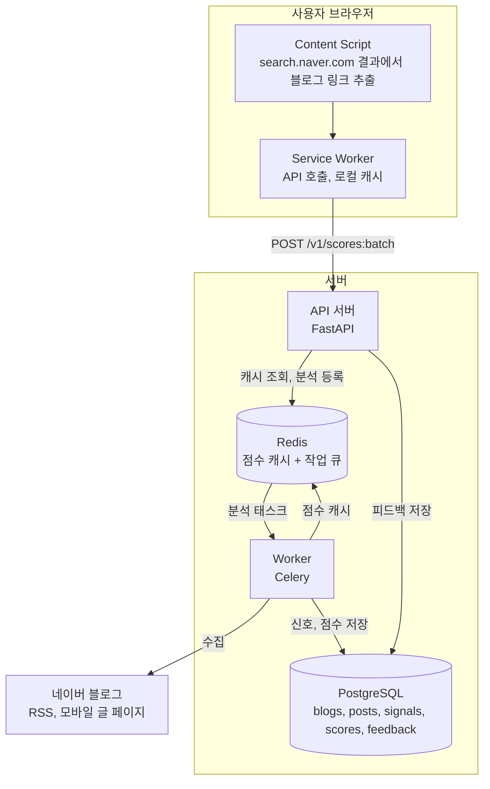
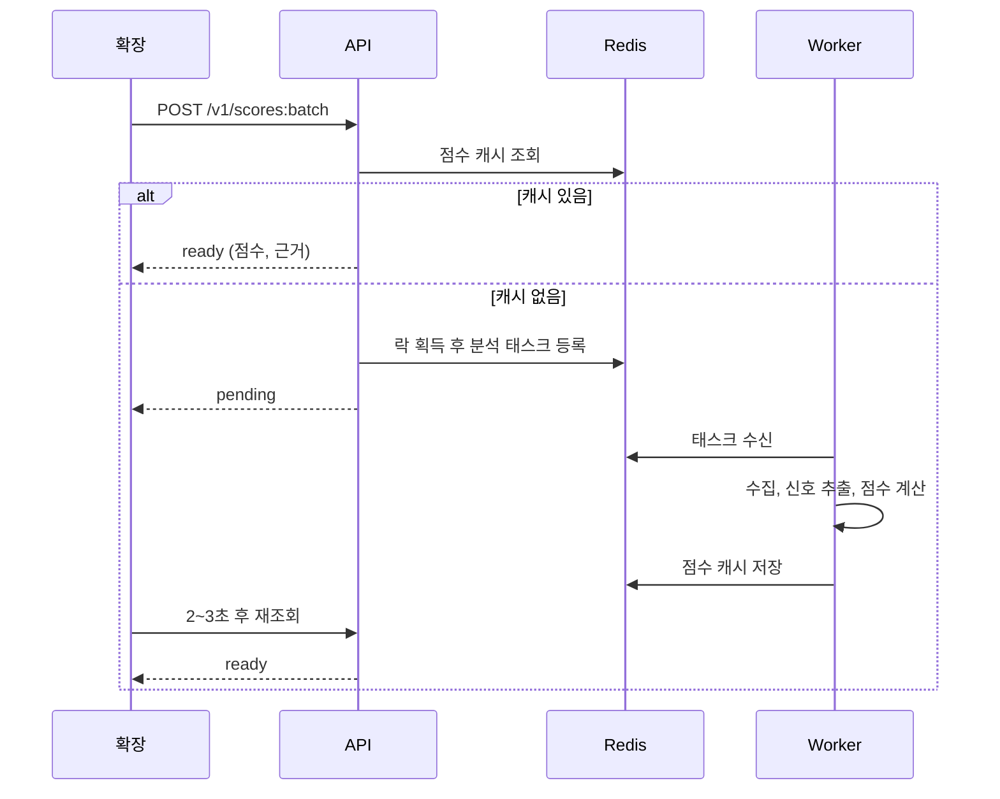

# 양산형 블로그 필터 — 1단계 아키텍처 & 기술 스택

## 1단계 목표 (MVP)
- 네이버 검색 결과(통합검색의 블로그 영역, 블로그 탭)에 **블로그별 "양산형 의심도" 배지**를 붙인다.
- 판정은 **규칙 기반 신호**로만 한다 (ML/LLM은 3단계).
- 판정 근거(신호 원본)를 저장해 2~3단계의 학습 feature와 평가셋 시드로 재사용한다.

**범위 밖:** 구글/티스토리, 글 단위 LLM 판정, 이미지 분석 (4단계)

---

## 전체 구조



| 구성 요소 | 역할 |
|---|---|
| Content Script | 검색 결과 DOM에서 블로그 글 링크를 찾고 배지를 그린다 |
| Service Worker | 서버 API 호출, 확장 로컬 캐시, `pending` 재조회 |
| API 서버 | 캐시된 점수를 즉시 응답하고, 없는 블로그는 분석을 등록한다 |
| Redis | 블로그 점수 캐시, 중복 분석 방지 락, Celery 브로커 |
| Worker | 수집 → 신호 추출 → 점수 계산 → 저장 |
| PostgreSQL | 신호 원본과 점수 이력, 사용자 피드백 (이후 ML 학습 데이터) |

### 요청 흐름



1. 검색 결과 로드 → content script가 결과 항목의 블로그 링크를 수집 (최대 10~30개)
2. service worker가 로컬 캐시를 확인하고, 없는 것만 묶어 배치 요청
3. 서버: 캐시 히트는 즉시 `ready`, 미스는 큐에 넣고 `pending`
4. 확장은 `pending` 항목을 2~3초 간격으로 최대 N회 재조회 (1단계는 short polling, 이후 SSE 검토)
5. 결과가 오면 배지 렌더링: 🟢 낮음 / 🟡 보통 / 🔴 높음 + 툴팁에 근거 표시

---

## 기술 스택

| 영역 | 선택 | 이유 |
|---|---|---|
| 확장 | TypeScript + Manifest V3 + WXT(또는 Vite+CRXJS) | MV3 필수, 빌드/핫리로드 편의 |
| API | Python 3.12 + FastAPI + Pydantic v2 | 3단계 ML 코드와 언어 통일, 비동기 |
| 작업 큐 | Celery + Redis | 국내 채용 공고에서 인지도 높음, 재시도·rate limit 내장 |
| 크롤링 | httpx(async) + selectolax | 빠른 HTML 파싱 |
| DB | PostgreSQL 16 + SQLAlchemy 2 + Alembic | 신호는 JSONB로 유연하게 저장 |
| 캐시 | Redis | 점수 캐시(TTL 24h~7d), 크롤링 결과 단기 캐시 |
| 인프라 | Docker Compose → 소형 VM 1대 | 1단계는 단일 서버로 충분 |
| 관측 | 구조화 로그 + Prometheus/Grafana | 지연·캐시 히트율 등 성능 지표 수집 |
| 테스트 | pytest + 저장해둔 HTML fixture | 네이버 DOM 변경에 대비한 회귀 테스트 |

---

## 데이터 수집 전략
- **글 본문:** `m.blog.naver.com/{blogId}/{logNo}` 같은 모바일 페이지를 사용 (PC 버전은 iframe 구조라 까다로움)
- **블로그 단위 통계:** 블로그 RSS로 최근 글 목록과 날짜, 카테고리를 수집
- **보조:** NAVER API HUB 검색 API(블로그) — bloggerlink, postdate 제공, 하루 호출 한도 25,000회
- **예의:** robots.txt 확인, 도메인별 초당 요청 제한, User-Agent 명시, 원문은 필요한 만큼만 보관

### DOM 변경 대응
- 클래스명 대신 **링크 패턴**(`blog.naver.com/{id}/{logNo}`)으로 결과 항목을 탐지
- 셀렉터는 `selectors.ts` 한 파일에 격리하고, 탐지 실패율을 로그로 수집

---

## 규칙 기반 신호 (rule v1)

**블로그 단위**
- `posts_per_day_30d` — 최근 30일 일평균 포스팅 수
- `category_entropy` — 주제 분산도 (관련 없는 주제가 섞이면 높음)
- `affiliate_ratio` — 제휴 링크/공정위 문구가 들어간 글의 비율
- `title_template_similarity` — 최근 글 제목들의 구조 유사도

**글 단위**
- `keyword_density` — 제목 키워드의 본문 반복 밀도
- `structure_template_score` — 소제목·목차 패턴이 정형화된 정도
- `image_count`, `text_length`, `has_personal_markers`(날짜·가격·장소 등 구체적 경험 표현)

**점수:** 신호별 정규화 → 가중합 → 0~100. `scoring_version`을 함께 저장해 규칙 변경 전후를 비교할 수 있게 한다.

---

## DB 스키마 (초안)

```sql
blogs(id, blog_id UNIQUE, name, first_seen_at, last_crawled_at)
posts(id, blog_id FK, log_no, title, posted_at, content_hash, crawled_at)
signals(id, target_type['blog'|'post'], target_id, payload JSONB, extractor_version, created_at)
scores(id, target_type, target_id, score INT, reasons JSONB, scoring_version, created_at)
feedback(id, target_type, target_id, user_hash, label['spam'|'ok'], created_at)
```

- **feedback:** 확장의 배지 툴팁에 "판정이 틀렸어요" 버튼 → **2단계 평가셋 시드**로 활용

---

## API 명세 (초안)

```
POST /v1/scores:batch
  req:  { "items": [{ "url": "https://blog.naver.com/abc/2234..." }, ...] }
  res:  { "results": [{ "url": "...", "status": "ready|pending|invalid",
                        "blog_id": "abc", "score": 72, "level": "high",
                        "reasons": ["최근 30일 하루 평균 6.2개 포스팅", "제휴 링크 비율 80%"] }] }

POST /v1/feedback
  req:  { "url": "...", "label": "spam|ok", "client_id": "확장 설치 ID (선택, 서버에는 해시만 저장)" }

GET  /healthz, /metrics
```

- 한 요청에 최대 30개. 네이버 블로그 글 URL이 아닌 항목은 `invalid`로 응답하고 나머지는 정상 처리한다.
- 점수는 블로그 단위로 Redis에 캐시한다 (`score:blog:{blogId}`). 캐시에 없는 블로그는 `crawl:requested` 집합에 넣고 `pending`으로 응답하며, 2주차 워커가 이 집합을 처리한다.
- level 기준: 0~39 low, 40~69 medium, 70~100 high

---

## 측정 지표
- p50/p95 응답 지연 (캐시 히트 / 미스 구분)
- 캐시 히트율, 크롤링 실패율, 결과 항목 탐지 실패율
- 검색 1회당 평균 신규 크롤링 수

---

## 작업 순서 (약 3~4주)

| 주차 | 내용 | 상세 문서 | 상태 |
|---|---|---|---|
| 1주차 | 서버 뼈대, DB 스키마, Docker Compose, CI | [02](02-week1-server-skeleton.md) | 완료 |
| 2주차 | 크롤러, 신호 추출, rule v1 스코어러, Celery 워커 | [03](03-week2-worker-pipeline.md) | 진행 중 |
| 3주차 | 크롬 확장, 배지 UI, API 연동 | - | 예정 |
| 4주차 | 캐싱·rate limit 개선, 메트릭 대시보드, README | - | 예정 |

1. **1주차:** 모노레포 세팅(`extension/`, `server/`, `infra/`), Docker Compose(Postgres, Redis), FastAPI 뼈대
2. **2주차:** 크롤러 + 신호 추출 + rule v1 스코어러, HTML fixture 테스트
3. **3주차:** 확장 content script + service worker + 배지 UI, 배치 API 연동
4. **4주차:** 캐싱·rate limit 다듬기, 메트릭 대시보드, README(아키텍처 그림, 측정 결과)
