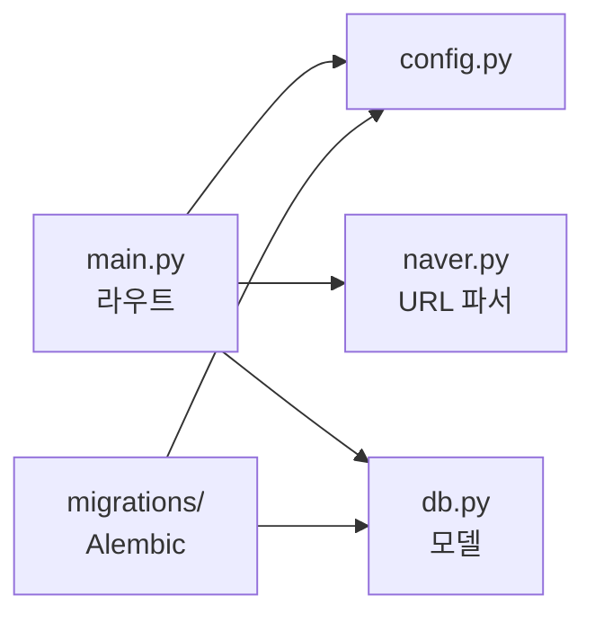
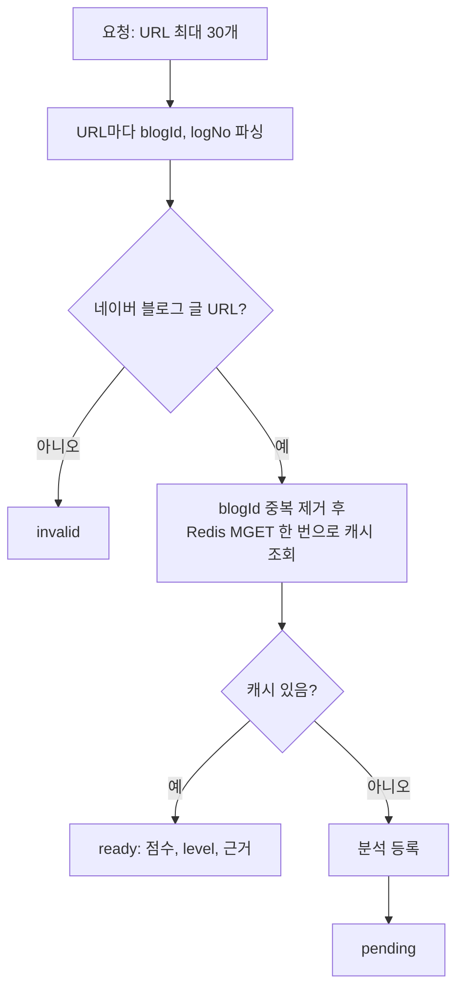
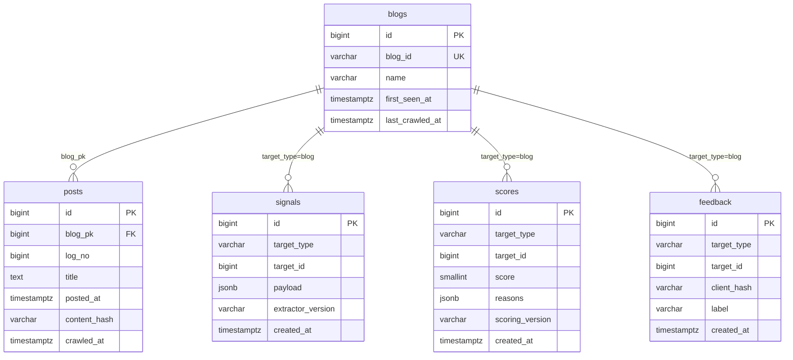
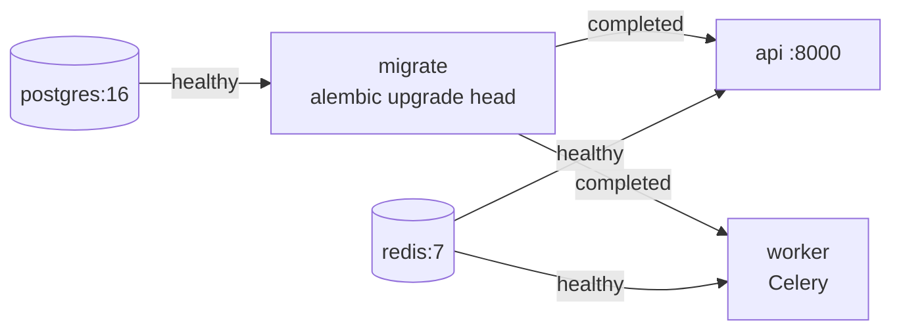
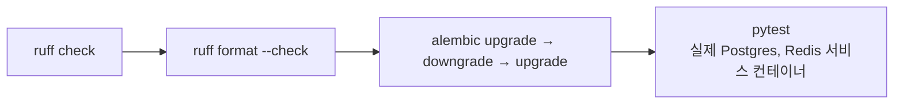

# 1주차 — API 서버 뼈대, DB 스키마, 실행 환경

> 관련 PR: #2 · 상위 설계: [01 1단계 아키텍처](01-stage1-architecture.md)

## 목표
- 확장이 호출할 API의 **응답 형태를 먼저 고정**해서 3주차 확장 개발과 병렬로 진행할 수 있게 한다.
- 이후 ML 단계까지 그대로 쓸 **DB 스키마**와 마이그레이션 체계를 잡는다.
- 로컬(Docker Compose)과 CI에서 **같은 방식으로 실행되는 환경**을 만든다.

---

## 코드 구조

```
server/
├─ app/
│  ├─ main.py        FastAPI 앱, 라우트, 의존성 (세션, Redis, 작업 등록)
│  ├─ config.py      환경변수 기반 설정 (ACF_ 접두사)
│  ├─ naver.py       네이버 블로그 URL 파서
│  ├─ db.py          SQLAlchemy 모델
│  └─ cache.py       Redis 키 규칙          ← 2주차에 분리
├─ migrations/       Alembic (async)
└─ tests/            실제 PostgreSQL, Redis를 쓰는 pytest
infra/docker-compose.yml
.github/workflows/server-ci.yml
```



---

## API 처리 흐름

### `POST /v1/scores:batch`



- **블로그 단위로 판정한다.** 같은 블로그의 글이 검색 결과에 여러 개 나와도 캐시 조회와 분석은 한 번만 일어난다.
- 잘못된 URL이 섞여도 요청 전체를 실패시키지 않고 해당 항목만 `invalid`로 돌려준다.
- level 기준: 0~39 `low`, 40~69 `medium`, 70~100 `high` (평가셋 구축 후 조정)

### `POST /v1/feedback`
- 배지의 "판정이 틀렸어요" 버튼에서 호출한다. 블로그가 DB에 없으면 먼저 만든 뒤(`ON CONFLICT DO NOTHING`) 피드백을 저장한다.
- `client_id`(확장 설치 ID)는 SHA-256 해시로만 저장한다.

### `GET /healthz`
- DB `SELECT 1`과 Redis `PING`을 각각 확인하고, 하나라도 실패하면 503을 돌려준다.

---

## DB 스키마



설계 포인트
- `signals`, `scores`, `feedback`은 `(target_type, target_id)`로 블로그와 글을 모두 가리킨다. 1단계는 블로그 단위만 쓰지만 글 단위 판정을 추가할 때 스키마를 바꾸지 않아도 된다.
- `signals.payload`는 JSONB라서 신호를 추가해도 마이그레이션이 필요 없다. `extractor_version`으로 어떤 로직이 만든 값인지 구분한다.
- `scores`는 덮어쓰지 않고 **이력으로 쌓는다.** `scoring_version`별로 규칙 변경 전후를 비교할 수 있다.
- 값의 범위는 DB 제약으로도 막는다: `score BETWEEN 0 AND 100`, `label IN ('spam','ok')`, `target_type IN ('blog','post')`.

---

## 실행 환경

### Docker Compose



- `migrate` 서비스가 성공적으로 끝나야 API와 워커가 뜬다. 스키마가 없는 상태로 서버가 요청을 받는 일을 막는다.
- worker는 2주차에 추가됐다.

### CI (GitHub Actions)



- 마이그레이션을 올렸다 내렸다 다시 올려서 `downgrade` 경로도 깨지지 않았는지 매번 확인한다.
- 테스트는 mock DB가 아닌 **실제 PostgreSQL**을 쓴다. JSONB, `ON CONFLICT`, CHECK 제약처럼 Postgres 고유 동작을 그대로 검증하기 위해서다.
