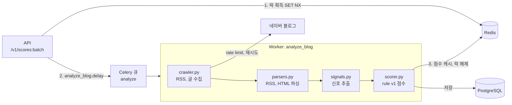
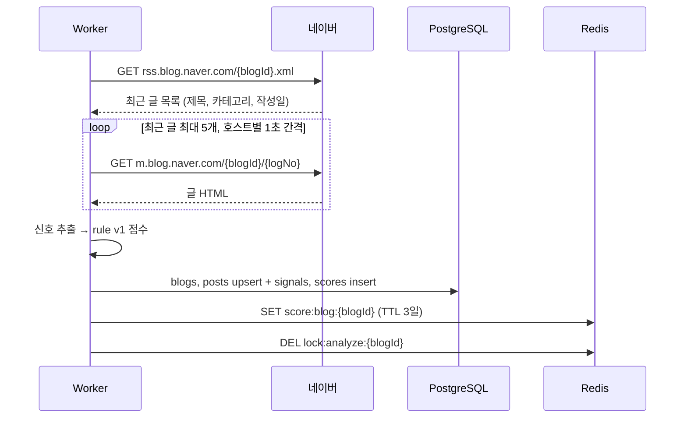
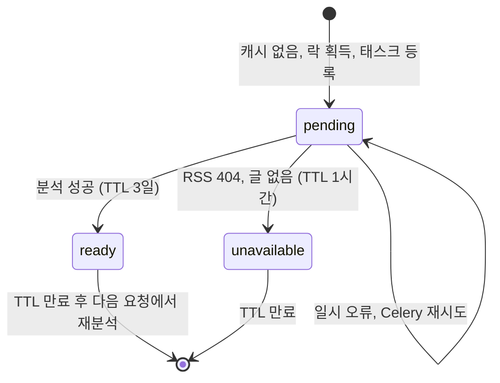
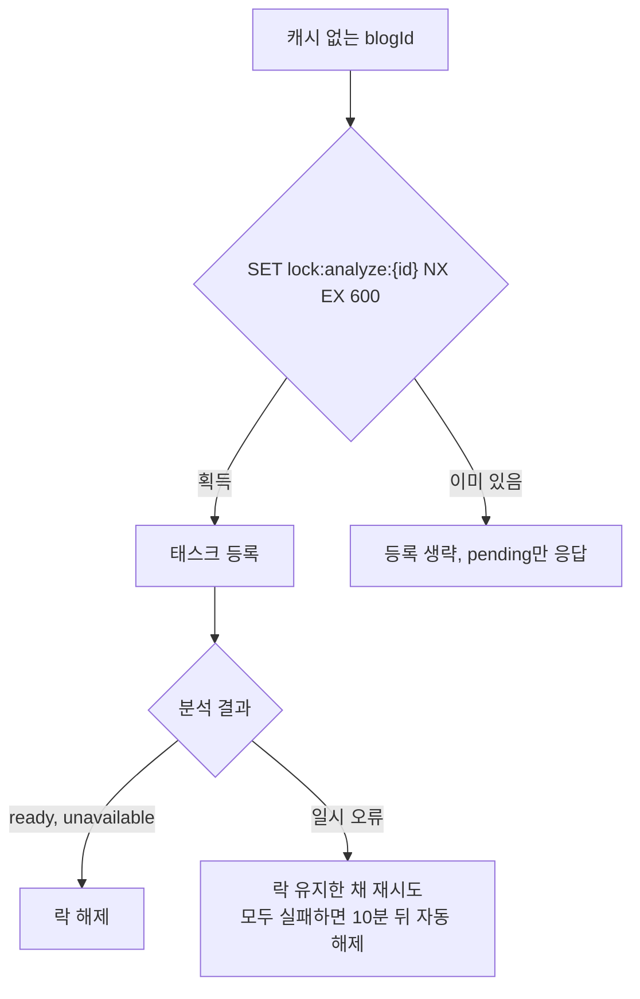
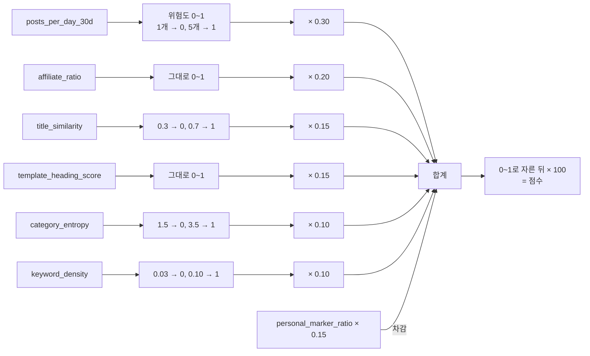

# 2주차 — 수집·분석 워커 파이프라인

> 상위 설계: [01 1단계 아키텍처](01-stage1-architecture.md) · 이전 단계: [02 1주차](02-week1-server-skeleton.md)

## 목표
- `pending`으로만 쌓이던 블로그를 **실제로 수집하고 점수를 매겨** `ready`로 바꾼다.
- 신호 원본을 저장해서 이후 평가셋 구축과 ML 학습에 그대로 쓸 수 있게 한다.
- 네이버에 부담을 주지 않도록 **요청 간격, 재시도, 중복 분석 방지**를 기본으로 넣는다.

---

## 구성

### 모듈 구조

| 파일 | 역할 | 외부 의존 |
|---|---|---|
| `app/crawler.py` | HTTP 수집, 호스트별 요청 간격, 재시도 | httpx |
| `app/parsers.py` | RSS와 모바일 글 페이지를 데이터 클래스로 변환 | defusedxml, selectolax |
| `app/signals.py` | 신호 계산 (순수 함수) | 없음 |
| `app/scorer.py` | 신호 → 0~100 점수와 근거 (순수 함수) | 없음 |
| `app/pipeline.py` | 위 단계를 엮고 DB, Redis에 저장 | SQLAlchemy, redis |
| `app/worker.py` | Celery 태스크 진입점 | celery |

신호와 점수 계산은 I/O가 없는 순수 함수로 분리했다. 저장된 신호 원본만으로 언제든 다시 계산할 수 있고, 테스트도 네트워크 없이 빠르게 돈다.

---

## 분석 태스크 흐름

- **RSS로 블로그 전체 패턴**(글 빈도, 주제 분산, 제목 틀)을 보고, **최근 글 5개 본문으로 내용 패턴**(제휴 링크, 소제목 틀, 키워드 반복)을 본다.
- 본문 수집에 실패한 글(404, 본문 영역 없음)은 건너뛰고 나머지로 계산한다.

### 결과 상태

---

## 중복 분석 방지 (락)

같은 블로그가 여러 사용자의 검색 결과에 동시에 나와도 분석은 한 번만 돈다. 재시도 중에도 락을 유지해서 같은 블로그가 큐에 쌓이지 않는다.

---

## 수집 정책

| 항목 | 값 | 설정 |
|---|---|---|
| 호스트별 최소 요청 간격 | 1초 | `ACF_CRAWL_MIN_INTERVAL_SEC` |
| 블로그당 본문 수집 글 수 | 5개 | `ACF_SAMPLE_POSTS` |
| 재시도 대상 | 429, 5xx, 네트워크 오류 | - |
| 재시도 방식 | HTTP 1·2·4초 백오프 3회, 이후 Celery 재시도 30초 백오프 3회 | - |
| 404 | 재시도 없이 `unavailable` | - |
| 그 외 4xx | 재시도 없이 실패 | - |
| 태스크 처리량 제한 | 워커당 분당 30개 | `rate_limit` |
| User-Agent | 프로젝트 이름과 저장소 주소 명시 | - |

- RSS 파싱은 `defusedxml`을 써서 엔티티 확장 공격(billion laughs)을 막는다.
- 네이버 주소는 설정(`ACF_NAVER_RSS_BASE`, `ACF_NAVER_POST_BASE`)으로 바꿀 수 있다. 로컬 가짜 서버로 엔드투엔드 테스트를 할 때 쓴다.

---

## 신호 (signals-v1)

| 신호 | 출처 | 계산 | 의미 |
|---|---|---|---|
| `posts_per_day_30d` | RSS | 최근 30일 글 수 ÷ 기간(일) | 하루에 몇 개씩 찍어내는지 |
| `category_entropy` | RSS | 카테고리 분포의 섀넌 엔트로피(bit) | 관련 없는 주제를 얼마나 넓게 다루는지 |
| `title_similarity` | RSS | 최근 제목 20개의 평균 쌍별 유사도 (숫자 제거 후) | "2025 OO 추천 TOP N 총정리" 같은 틀 반복 |
| `affiliate_ratio` | 본문 | 제휴 링크나 공정위 문구가 있는 글 비율 | 수익형 글 비중 |
| `template_heading_score` | 본문 | 목차·결론·총정리 등 템플릿 소제목 개수 ÷ 3 (최대 1) | 자동 생성형 글 구조 |
| `keyword_density` | 본문 | 제목 단어의 본문 등장 횟수 ÷ 본문 어절 수 | SEO용 키워드 반복 |
| `personal_marker_ratio` | 본문 | "다녀왔", "직접 써봤", "남편" 등 경험 표현이 있는 글 비율 | 직접 경험 글 (감점 요인) |
| `avg_image_count`, `avg_text_length` | 본문 | 평균 | 기록용, 점수에는 아직 미사용 |

**글 빈도 계산 보정:** RSS는 최근 글 일부만 주기 때문에, 하루 10개씩 쓰는 블로그는 피드 전체가 며칠 안에 끝난다. 그래서 30일이 아니라 **피드가 실제로 덮는 기간**으로 나눈다. 하루에 몰아 쓴 글 2개를 "하루 2개"로 과대평가하지 않도록 분모는 최소 7일로 둔다.

---

## 점수 계산 (rule-v1)

- 각 신호를 구간 안에서 선형으로 0~1 위험도로 바꾸고 가중합한다.
- **근거(reasons):** 위험도 0.5 이상인 신호를 기여도 순으로 최대 4개 보여준다. 경험 표현이 많으면 감점 요인도 함께 표시한다.
- 임계값과 가중치는 직관에 기반한 초기값이다. 3단계에서 라벨링한 평가셋으로 조정하거나 학습 모델로 대체한다.

### 예시 (테스트 fixture 기준)

| | 양산형 예시 (`info_bot`) | 개인 블로그 예시 (`walker`) |
|---|---|---|
| 하루 평균 글 수 | 4.3 | 0.1 |
| 카테고리 엔트로피 | 3.3 bit (주제 10개) | 0.9 bit |
| 제목 유사도 | 0.74 | 0.21 |
| 제휴 링크 비율 | 100% | 0% |
| 템플릿 소제목 | 1.0 | 0.0 |
| 경험 표현 | 0% | 100% |
| **점수** | **94 (high)** | **0 (low)** |

---

## 데이터 저장

| 테이블 | 동작 |
|---|---|
| `blogs` | upsert (이름, 마지막 수집 시각 갱신) |
| `posts` | `(blog_pk, log_no)` 기준 upsert. 본문 원문은 저장하지 않고 SHA-256 해시만 저장 |
| `signals` | 분석할 때마다 insert (`extractor_version = signals-v1`) |
| `scores` | 분석할 때마다 insert (`scoring_version = rule-v1`), 이력 유지 |

---

## 검증

- **단위 테스트:** 파서(스마트에디터 ONE, 구 에디터, 깨진 RSS, XML 엔티티 공격), 크롤러(재시도, 404, rate limit), 신호와 점수 경계값
- **파이프라인 테스트:** 실제 PostgreSQL, Redis에 저장·캐시·락 해제 확인, 일부 글 실패, 블로그 없음, 일시 오류 시 락 유지, 재분석 시 이력 누적
- **엔드투엔드:** API → Redis → 실제 Celery 워커 → DB 흐름을 로컬 가짜 네이버 서버로 확인 (`pending` → `ready` / `unavailable`)

## 한계와 다음 단계

- **실제 네이버 페이지로는 아직 검증하지 않았다.** 개발 환경에서 네이버 접속이 막혀 있어, fixture는 공개된 페이지 구조를 본떠 직접 만들었다. 실제 RSS와 글 HTML을 받아 fixture를 교체하고 파서를 확인해야 한다.
- 경험 표현과 템플릿 소제목은 단순 키워드 매칭이라 오탐이 있을 수 있다. 평가셋으로 정밀도를 측정한 뒤 보완한다.
- 이미지 신호(재사용 이미지, AI 생성 이미지)는 4단계에서 추가한다.
