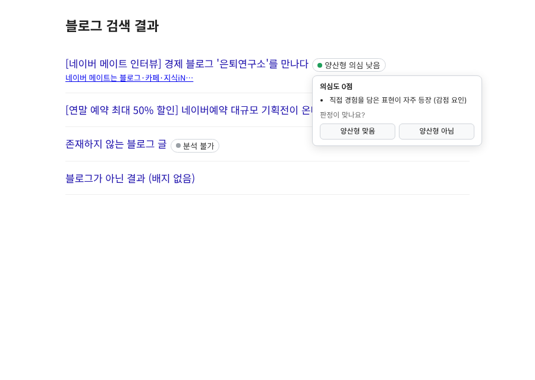
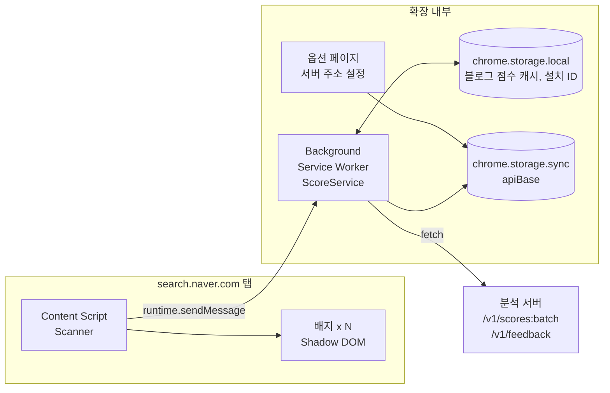
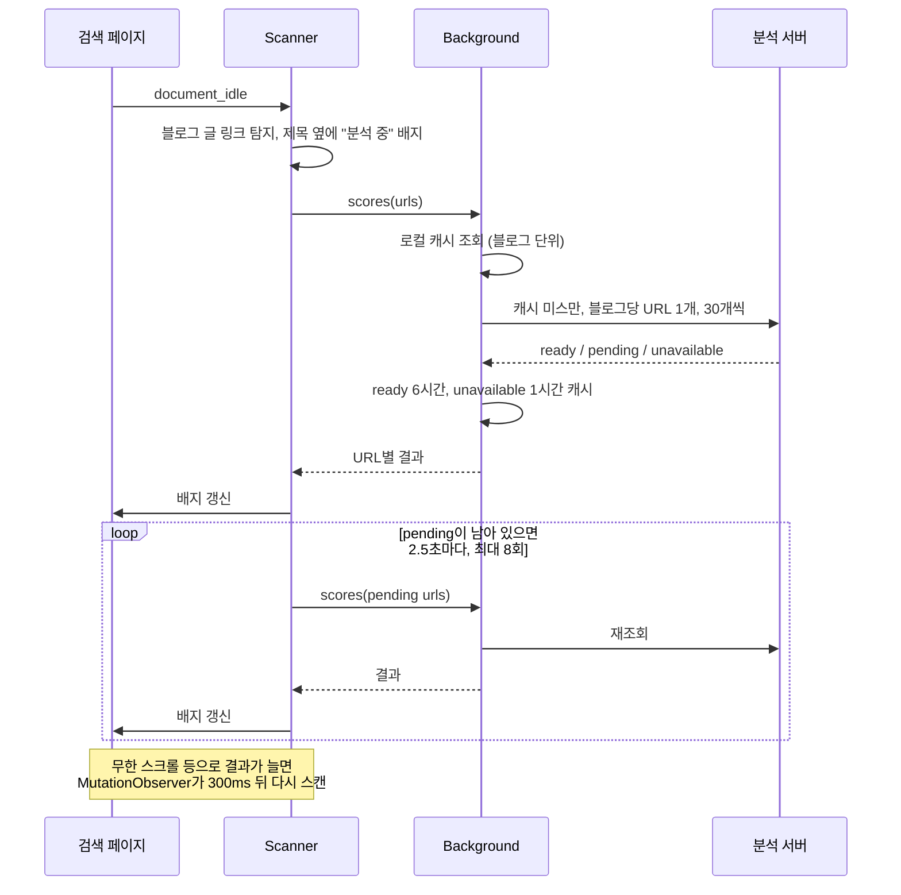
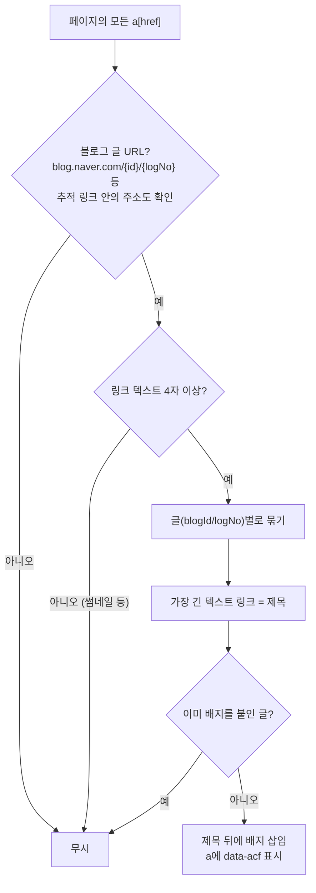
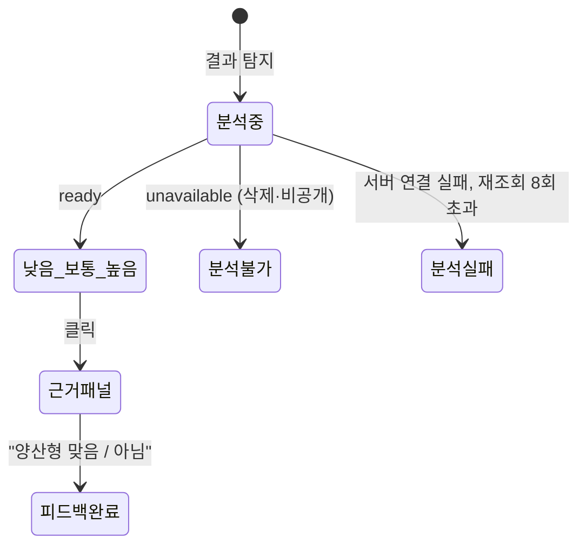

# 3주차 — 크롬 확장: 검색 결과 배지

> 상위 설계: [01 1단계 아키텍처](01-stage1-architecture.md) · 이전 단계: [03 2주차 워커](03-week2-worker-pipeline.md)

## 목표
- 네이버 검색 결과의 블로그 글 옆에 **양산형 의심도 배지**를 붙인다.
- 배지를 누르면 **점수와 근거**를 보여주고, 사용자가 **판정 피드백**을 남길 수 있게 한다.
- 네이버 검색 화면의 클래스명이 바뀌어도 쉽게 깨지지 않게 만든다.

*실제 Chrome에 확장을 올리고, 실제 API 서버와 워커가 네이버 공식 블로그를 분석한 결과 (검색 화면은 e2e용으로 단순화한 페이지)*

---

## 구성

| 파일 | 역할 |
|---|---|
| `entrypoints/content.ts` | 검색 페이지에 주입. Scanner 실행, background와 메시지 교환 |
| `entrypoints/background.ts` | 서버 호출 담당. content script는 서버와 직접 통신하지 않는다 |
| `entrypoints/options/` | 분석 서버 주소 설정, 연결 확인 |
| `lib/scanner.ts` | 결과 탐지, 배지 삽입, `pending` 재조회, DOM 변화 감지 |
| `lib/badge.ts` | 배지와 근거 패널 UI |
| `lib/service.ts` | 로컬 캐시, 배치 요청, 피드백 전송 (chrome API 없이 테스트 가능하게 주입식) |
| `lib/naver.ts` | 블로그 글 URL 파서 (서버 `app/naver.py`와 같은 규칙) |

**서버 호출을 background에 모은 이유:** content script에서 직접 부르면 네이버 페이지 기준의 CORS 제약을 받는다. background는 확장 권한(`host_permissions`)으로 호출하므로 서버에 CORS 설정이 필요 없고, 캐시도 탭끼리 공유된다.

---

## 처리 흐름

### 결과 탐지: 클래스명 대신 링크 패턴

한 검색 결과에는 같은 글로 가는 링크가 썸네일, 제목, 요약문 등 여러 개 있다. 텍스트가 가장 긴 링크를 제목으로 보고 배지는 그 뒤에 하나만 붙인다.

### 배지 상태

| 상태 | 표시 |
|---|---|
| low / medium / high | 초록 / 노랑 / 빨강 점 + "양산형 의심 낮음·보통·높음" |
| 분석 중 | 회색 점 깜빡임 |
| 분석 불가 | 삭제되었거나 비공개인 블로그 |
| 분석 실패 | 서버 연결 실패 또는 재조회 한도 초과 |

---

## UI 설계 포인트

- **Shadow DOM으로 격리:** 네이버 페이지 CSS가 배지에 영향을 주지 않고, 배지 CSS도 페이지를 건드리지 않는다.
- **링크 안에 들어가도 안전:** 배지 클릭은 `preventDefault`로 막아 검색 결과 페이지로 이동하지 않는다.
- **서버 문자열 이스케이프:** 근거 문구는 HTML로 해석하지 않는다 (테스트로 고정).
- **low에서는 위험 근거를 숨긴다:** 초록 배지 옆에 위험 문구가 보이는 혼란을 막는다 (서버 쪽 규칙).

## 권한

| 권한 | 이유 |
|---|---|
| `storage` | 점수 캐시, 설치 ID, 서버 주소 |
| `host_permissions`: `localhost:8000`, `127.0.0.1:8000` | 기본 분석 서버 |
| `optional_host_permissions`: 모든 http(s) | 옵션에서 다른 서버 주소를 저장할 때 **그 주소만** 사용자 승인으로 요청 |
| content script: `search.naver.com`, `m.search.naver.com` | 배지를 붙일 페이지 |

방문 기록, 탭 목록 같은 권한은 쓰지 않는다. 서버로 가는 정보는 검색 결과의 블로그 글 URL과, 피드백 시 익명 설치 ID(서버에는 해시만 저장)뿐이다.

---

## 검증

| 종류 | 내용 |
|---|---|
| 단위 테스트 (Vitest, jsdom) 24개 | URL 파서, 캐시·배치·TTL, 결과 탐지, 재조회·포기, 중복 배지 방지, 무한 스크롤 추가분, 서버 장애, 클릭 시 이동 차단, 피드백, XSS 이스케이프 |
| 타입 검사 | `tsc --noEmit` (strict) |
| e2e (실제 Chrome) | 빌드한 확장을 Chrome에 올리고, 실제 API 서버와 Celery 워커로 네이버 공식 블로그 분석 → 배지 표시 → 근거 패널 → 피드백 저장까지 확인 |
| CI | `extension-ci`: 타입 검사, 테스트, 빌드, 빌드 결과물 업로드 |

e2e 결과
- 처음 열었을 때: 모두 "분석 중" → 워커 분석 후 "양산형 의심 낮음" 2개(같은 블로그), "분석 불가" 1개(없는 블로그)
- 두 번째 실행: 서버 캐시 덕분에 처음부터 결과 표시
- 블로그가 아닌 링크에는 배지가 붙지 않음

## 한계와 다음 단계

- **실제 네이버 검색 결과 화면으로는 아직 검증하지 않았다.** 작업 환경에서 `search.naver.com` 접속이 막혀 있어, e2e는 링크 구조만 흉내 낸 페이지로 했다. 실제 화면에서 제목 링크를 제대로 고르는지, 배지 위치가 자연스러운지 확인이 필요하다.
- 배지를 제목 링크 바로 뒤에 붙이므로, 제목이 줄바꿈되는 레이아웃에서는 위치가 어색할 수 있다.
- 4주차: 실제 화면 검증, 캐시와 재조회 간격 조정, 메트릭 대시보드.
