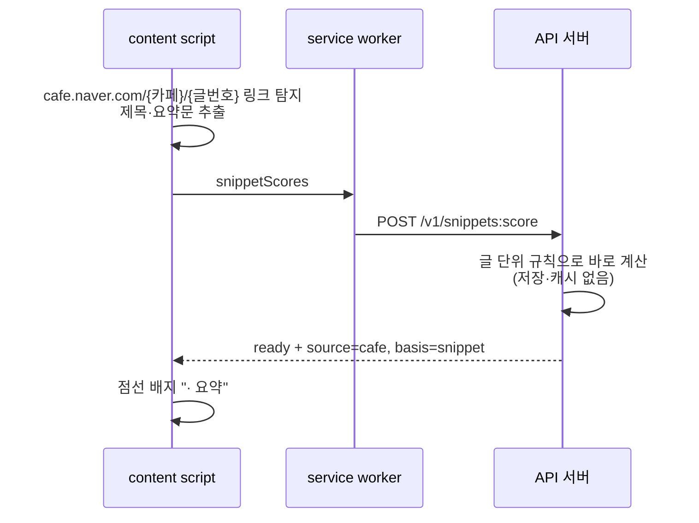
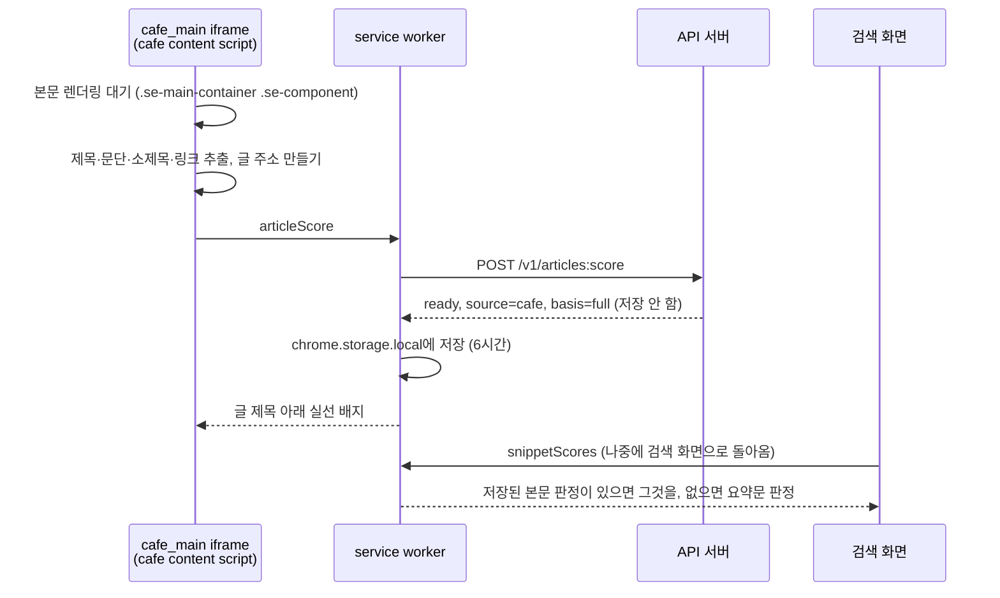

# 카페 글 지원: 검색 결과 문구로 판정

## 배경
- 네이버 검색의 "블로그·카페" 영역에는 카페 글이 블로그 글과 같은 모양의 카드로 섞여 나온다. 블로그만 분석하면 결과의 절반 가까이가 배지 없이 남는다.
- 실제 검색 3건에서 확인한 결과, 블로그 글은 모두 배지가 붙었고 배지가 없던 결과는 대부분 카페 글이었다.

## 서버가 카페를 수집하지 않는 이유
`cafe.naver.com`, `m.cafe.naver.com`, `article.cafe.naver.com`, `apis.naver.com`의 robots.txt가 모두 `User-agent: *` / `Disallow: /`다. 1단계 수집 원칙(robots.txt 준수)에 따라 서버는 카페 글을 가져오지 않는다.

## 방식

| 단계 | 판정 근거 | 상태 |
|---|---|---|
| 1. 검색 결과 | 검색 화면에 이미 보이는 제목·요약문 | 이번 변경 |
| 2. 글 열람 시 | 사용자가 연 카페 글 본문 (사용자 브라우저) | 구현 |

### `POST /v1/snippets:score`
- 요청: `{ "items": [{ "url", "title"(≤300자), "snippet"(≤2000자) }] }`, 최대 30개
- 응답: `/v1/scores:batch`와 같은 형식에 `source`(`blog`|`cafe`), `basis`(`full`|`snippet`)가 붙는다. 블로그 응답은 `blog`/`full`.
- **저장·캐시하지 않는다.** 문구는 클라이언트가 보내므로 조작될 수 있다. 공유 캐시에 넣으면 한 사용자가 다른 사용자의 배지를 바꿀 수 있어서, 요청마다 계산한다. 규칙 계산이라 비용은 거의 없다.
- 카페 글 URL이 아니면 `invalid`.

### 규칙 (snippet-v1)

| 신호 | 가중치 | 위험 구간 | 근거 문구 |
|---|---|---|---|
| `sponsored` 협찬·제휴 문구 | 0.35 | 있음 | 협찬·제휴 문구가 보임 |
| `hashtag_count` 해시태그 수 | 0.30 | 3 → 10개 | 해시태그를 많이 나열 |
| `template_title` 총정리·TOP·추천 순위 제목 | 0.20 | 있음 | 정형화된 제목 |
| `keyword_density` 제목 키워드 반복 (해시태그 제외) | 0.15 | 0.15 → 0.40 | 제목 키워드를 요약문에 과하게 반복 |
| `personal_marker_ratio` 직접 경험 표현 | 감점 0.15 | | 직접 경험을 담은 표현 (감점 요인) |

블로그 규칙(rule-v1)과 같은 가중합·level 기준을 쓴다. 요약문은 짧아서 블로그 단위 신호(게시 빈도, 주제 분산)는 쓸 수 없다.

## 2단계: 글을 열었을 때 본문으로 판정

### 글 페이지 구조 (PC, 사용자가 직접 연 페이지에서 확인)
- 바깥 페이지는 `cafe.naver.com/{카페}/{글번호}`, 글은 같은 출처의 iframe `cafe_main`(`/ca-fe/cafes/{카페 숫자 ID}/articles/{글번호}`)에 뜬다.
- 본문은 블로그와 같은 스마트에디터 ONE 구조(`.se-main-container` 안의 `.se-component`)라 서버 블로그 파서와 같은 규칙으로 읽는다. 제목은 `.ArticleTitle .title_text`.
- 검색 결과와 같은 키(`cafe:{카페}/{글번호}`)를 만들려고, 카페 이름은 바깥 주소의 첫 경로에서, 글번호는 iframe 주소에서 가져온다. iframe 안에서 다른 글로 넘어가도 바깥 주소는 그대로일 수 있어서다.
- 본문은 스크립트가 나중에 그리므로, 컴포넌트가 생길 때까지 DOM 변화를 지켜보다 한 번 판정한다. 다른 글로 넘어가면 다시 판정한다.

### `POST /v1/articles:score`
- 요청: `{ url, title(≤300자), paragraphs(≤1000개, 각 ≤5000자), headings(≤200개), links(≤500개) }`. 확장이 보내기 전에 같은 한도로 자른다.
- 서버는 블로그 글에 쓰는 글 단위 신호 함수(`is_affiliate`, `template_heading_score`, `keyword_density`, `has_personal_markers`)를 그대로 쓴다. 규칙은 article-v1.

| 신호 | 가중치 | 위험 구간 |
|---|---|---|
| `sponsored` 협찬·제휴 문구 또는 제휴 링크 | 0.35 | 있음 |
| `template_heading_score` 템플릿형 소제목 | 0.25 | 0 → 1 |
| `keyword_density` 제목 키워드 반복 (해시태그 제외) | 0.20 | 0.03 → 0.10 |
| `hashtag_count` 해시태그 수 | 0.20 | 3 → 10개 |
| `personal_marker_ratio` 직접 경험 표현 | 감점 0.15 | |

- **본문도 클라이언트가 보내므로 서버는 저장하지 않는다.** 결과는 그 사용자의 브라우저(`chrome.storage.local`)에만 남겨, 그 사용자의 검색 화면에서만 요약문 판정 대신 쓴다.

## 배지 표시

| | 칩 | 근거 패널 첫 줄 |
|---|---|---|
| 블로그 | 실선 `양산형 의심 낮음` | 블로그 · 최근 글 분석 |
| 카페 (검색 결과) | 점선 `양산형 의심 낮음 · 요약` | 카페 글 · 검색 요약문만 분석 |
| 카페 (글을 연 뒤, 글 페이지와 검색 화면) | 실선 `양산형 의심 낮음` | 카페 글 · 본문 전체 분석 |

- 칩에는 판정 근거만 짧게 표시하고, 블로그·카페 구분은 패널에 둔다. 칩이 길어지면 검색 결과를 가린다.
- 점선은 "근거가 제한적"이라는 뜻이다. 색만으로 구분하지 않도록 `· 요약` 글자를 함께 쓴다.
- 카페 글 판정에는 피드백 버튼을 두지 않는다. `/v1/feedback`과 DB의 `feedback.target_type`이 아직 블로그 단위다.

## 검증
- 서버 테스트 74개: 카페 URL 파서, 요약문 신호·점수, 엔드포인트(저장하지 않음, 길이 제한, 카페가 아닌 URL)
- 확장 테스트 38개: 카페 URL 파서, 카페 결과 탐지(카페 홈 링크 제외), 요약문 전송, 배지 표시, 캐시하지 않음
- 실제 네이버 검색("용인 맛집", "무선청소기 추천")에 확장을 올려 블로그·카페 글 모두 배지가 붙는 것을 확인
- 2단계: 서버 테스트 77개(본문 판정, 저장하지 않음, 크기 제한), 확장 테스트 49개(글 주소 만들기, 본문 추출, 본문 판정 저장과 검색 화면 우선 적용, 배지)
- 2단계 e2e: 실제 Chrome과 API 서버로, 사용자가 확인해 준 구조를 흉내 낸 로컬 페이지(바깥 페이지 + iframe, 본문 지연 렌더링)에서 글 제목 아래 배지 → 검색 화면 배지가 본문 판정으로 바뀌는 것까지 확인. 카페 도메인은 자동화 접근이 막혀 있어 실제 카페 글로는 확인하지 못했다.

## 한계와 다음 단계
- 요약문은 두세 줄이라 판정이 약하다. 지금 규칙은 평가셋 없이 정한 초기값이다.
- 키워드 반복은 해시태그를 빼고 센다. `#용인맛집` 같은 해시태그가 해시태그 수와 키워드 반복에 이중으로 점수를 주던 문제를 고쳤다. 해시태그만으로 30점이 되는 해시태그 기준(3~10개, 가중치 0.30)은 평가셋을 쌓은 뒤 조정한다. 실제 사례: 일반 맛집 후기가 해시태그 14개짜리 요약문 때문에 42점(보통), 글을 연 본문 판정은 13점(낮음).
- 모바일 카페(`m.cafe.naver.com`)와 `/ca-fe/` 주소를 직접 연 경우(카페 이름을 알 수 없음)는 아직 판정하지 않는다.
- 다음 단계: 카페 글 피드백 저장.
